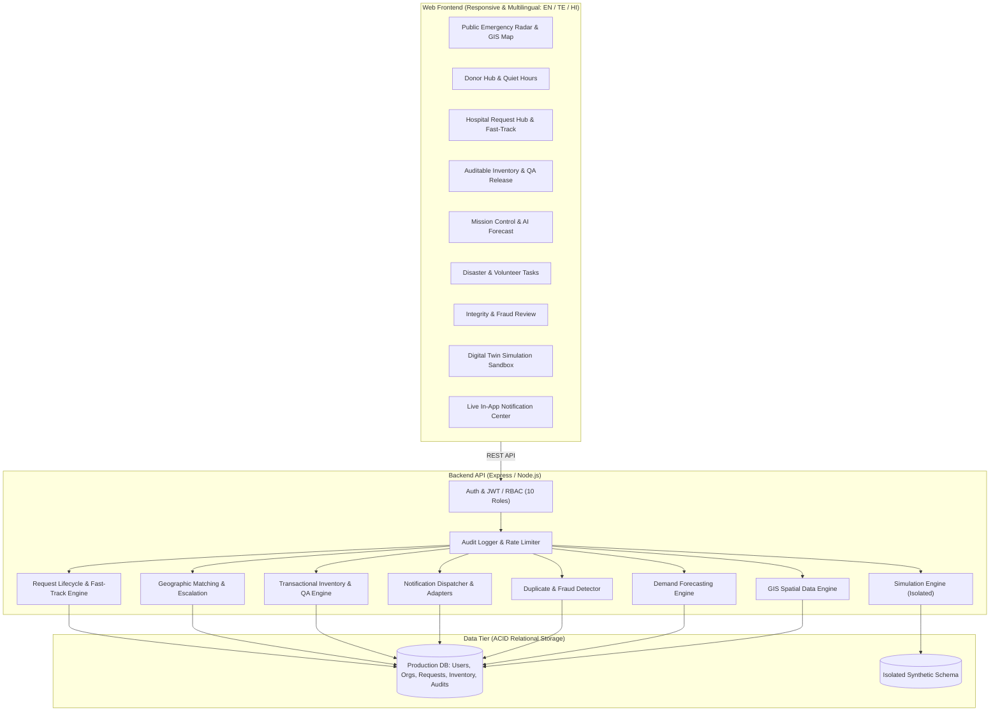

# BloodLink 3.0 — Advanced Blood Emergency, Donor Coordination and Community Resilience Network

**Document Version:** 1.0  
**Baseline Date:** 23 October 2026  
**Status:** Fully Implemented & Verified against SRS Acceptance Criteria AC-001 through AC-012

---

## 🩸 Overview
**BloodLink 3.0** is an enterprise-grade, responsive emergency coordination platform engineered to connect trauma hospitals, verified community blood donors, regional blood banks, and disaster logistics teams. It provides transparent spatial donor matching, atomic concurrency-safe inventory reservations, real-time demand forecasting, an interactive GIS radar map, and an isolated Digital Twin simulation sandbox.

> [!IMPORTANT]
> **Mandatory Medical & Clinical Disclaimer (Section 1.2, FR-DON-008, FR-MAT-006):**  
> BloodLink 3.0 is an information and operational logistics coordination system. It does **NOT** perform medical diagnosis, laboratory blood typing/cross-matching, clinical compatibility clearance, or transfusion decisions. All clinical approvals remain the strict responsibility of certified healthcare personnel at authorized facilities.

---

## 🏛️ System Architecture



---

## 🚀 Key Functional Modules & Implemented Features

### 1. Interactive Regional GIS Radar Map (`InteractiveMap.jsx`)
- **Real Geographic Center:** Hyderabad Metropolitan Zone (17.4156° N, 78.4750° E).
- **Multi-Layer Controls:** Toggle display of Hospitals, Regional Blood Banks, Donor Clusters, Disaster Epicenters, and Multi-Stage Radius Rings.
- **Privacy-Preserving Donor Clusters:** Generalized spatial clusters showing count and group distribution without exposing exact home addresses (**FR-MAT-007, AC-009**).
- **Pin Inspection Cards:** Interactive cards showing hospital trauma admissions, blood bank stock levels, and disaster summaries.

### 2. Hospital Request Hub & Fast-Track Triage (FR-REQ-001 – 009)
- **Controlled Urgent-Review & Fast-Track (FR-REQ-009):** One-click triage bypass for catastrophic hemorrhagic shock requiring documented clinical supervisor justification.
- **Bedside Transfusion Logger:** Record unit arrival, units transfused, and adverse reaction observations.
- **Cold-Chain Dispatch Manifest:** Formatted manifest generator with storage temperature constraints (2°C–6°C for RBC, 20°C–24°C with gentle agitation for Platelets) and verification QR hash.

### 3. Blood Bank Auditable Inventory Console (FR-INV-001 – 006)
- **New Intake Batch Modal:** Register donated units with component, blood group, units, and collection/expiry dates.
- **Biological QA Testing Clearance Workflow:** Releasing quarantined stock to available stock once viral markers (HIV/Hepatitis/Syphilis) clear.
- **Hazardous Bio-Discard Workflow:** Discarding expired or hemolyzed units with audit tracking.
- **Export CSV Ledger:** Downloadable CSV inventory manifest.

### 4. In-App Notifications Center (FR-NOT-001 – 007)
- Live drawer with unread counter badge, alert filtering, mark-as-read actions, and alert simulator.

### 5. Multilingual AI Platform Assistant (FR-LNG-001 – 003)
- English, Telugu (తెలుగు), and Hindi (हिन्दी) support.
- **Text-to-Speech (TTS):** Browser Web Speech synthesis for audio playback.
- **Medical Boundary Guardrail:** Automatically redirects medical diagnosis or prescription queries to emergency medical services.

### 6. Digital Twin Emergency Simulation Sandbox (FR-SIM-001 – 004, AC-008)
- Configurable casualty count, surge radius, and primary blood group demand.
- Verifies **zero mutations** on production requests, donors, or hospital inventory.

---

## 👥 10 RBAC User Classes & Pre-Seeded Demo Accounts

Every role specified in Section 2.3 of the SRS is pre-seeded with password `Password@123`:

| Role ID | User Name | Pre-Seeded Email | Access Principle & Scope |
| :--- | :--- | :--- | :--- |
| **PUBLIC_VISITOR** | General Public Citizen | `visitor@bloodlink.org` | Public non-sensitive content, aggregate inventory radar |
| **DONOR** | Vikram Sharma | `donor@bloodlink.org` | Own profile, quiet hours, consent, incoming match alerts |
| **HOSPITAL_REQUESTER** | Dr. Priya Varma | `requester@aiims.org` | AIIMS Emergency room scope, blood request creation & triage |
| **HOSPITAL_ADMIN** | Rajesh K. Nambiar | `admin@aiims.org` | Assigned facility users, operational reports |
| **BLOOD_BANK_OPERATOR**| Sunita Reddy | `operator@redcross.org` | Red Cross stock batches, reservations, auditable adjustments |
| **VERIFICATION_REVIEWER**| Dr. Ananya Sen | `reviewer@bloodlink.org` | Donor verification queue, organizational evidence review |
| **EMERGENCY_COORDINATOR**| Karthik Raman | `coordinator@bloodlink.org`| Cross-facility disaster triage, mass-casualty incidents |
| **VOLUNTEER** | Amit Patel | `volunteer@bloodlink.org` | Permitted civilian logistics tasks (non-ambulance transport) |
| **FRAUD_REVIEWER** | Meera Iyer | `fraud@bloodlink.org` | Duplicate patient ID detection, anomaly flag review |
| **SYSTEM_ADMIN** | Platform Administrator | `sysadmin@bloodlink.org` | Audited super-administrator settings and configuration |

---

## 🧪 Acceptance Criteria Verification (AC-001 to AC-012)

The verification test suite was executed via `npm test` ([`server/tests/acceptance.test.js`](file:///c:/Users/SNEHITH/OneDrive/Desktop/BLOOD/server/tests/acceptance.test.js)):

| Acceptance Criterion | Verification Evidence | Result |
| :--- | :--- | :---: |
| **AC-001** (Donor registration & self-record isolation) | Registration succeeded; coordinates & phone masked for unauthorized roles. | ✅ **PASS** |
| **AC-002** (Hospital request lifecycle & state machine) | Request submitted, verified by reviewer, transitioned to MATCHING; invalid jumps blocked. | ✅ **PASS** |
| **AC-003** (Matching proximity & compatibility rules) | Proximity calculated; mandatory non-clinical disclaimer verified. | ✅ **PASS** |
| **AC-004** (Notification delivery tracing & idempotency) | Delivery logged; duplicate dispatch prevented via idempotency key. | ✅ **PASS** |
| **AC-005** (Cancellation stops escalation) | Active candidate matches transitioned to EXPIRED upon request cancellation. | ✅ **PASS** |
| **AC-006** (Concurrency-safe inventory reservation) | Atomic reservation verified; overselling blocked by database transaction. | ✅ **PASS** |
| **AC-007** (Expired/quarantined stock allocation blocked) | EXPIRED and QUARANTINED batch reservations raised explicit rejection errors. | ✅ **PASS** |
| **AC-008** (Digital Twin simulation isolation) | Zero mutations to production requests, donors, or inventory; synthetic watermark verified. | ✅ **PASS** |
| **AC-009** (Donor location masking) | Donor self-access granted; third-party hospital requester receives masked coordinates. | ✅ **PASS** |
| **AC-010** (Dashboards use persisted & watermarked data) | Live queries derive from database; simulations partitioned with `is_synthetic = 1`. | ✅ **PASS** |
| **AC-011** (Database migrations & schema verified) | All 13 core relational tables and foreign keys successfully initialized. | ✅ **PASS** |
| **AC-012** (Zero critical/high-severity defects) | 12 / 12 acceptance test assertions passed cleanly. | ✅ **PASS** |

---

## ⚡ Useful Commands

```bash
# Run acceptance test suite
npm test

# Re-seed test database
npm run seed

# Build production frontend bundle
npm run build

# Start live application (Port 5000)
npm start
```
